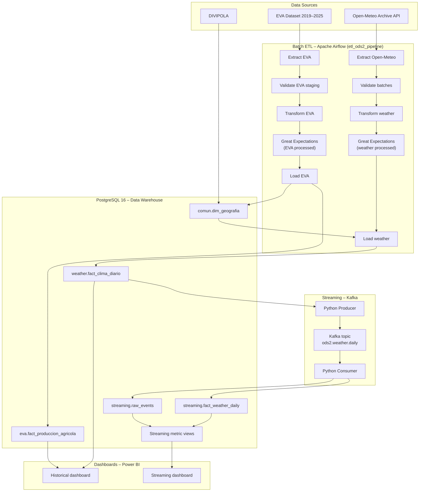
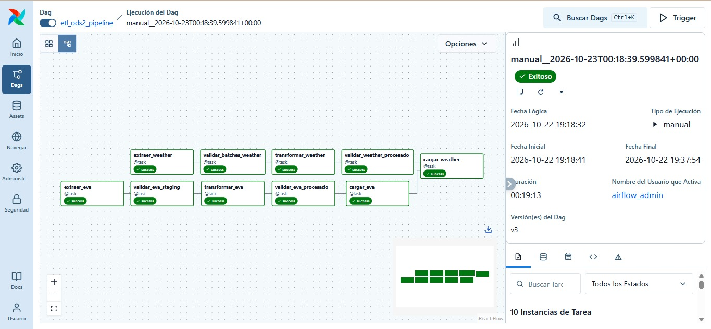
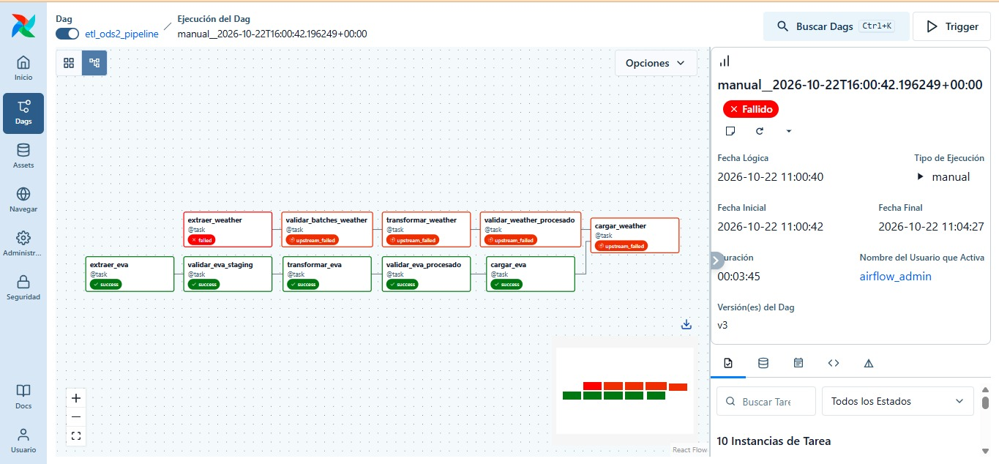
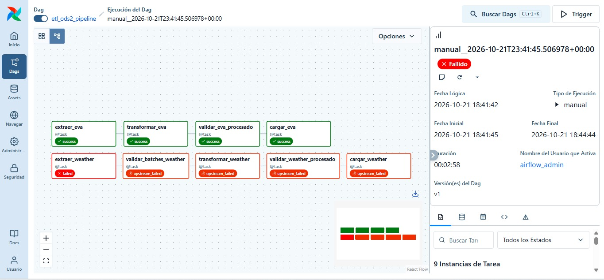
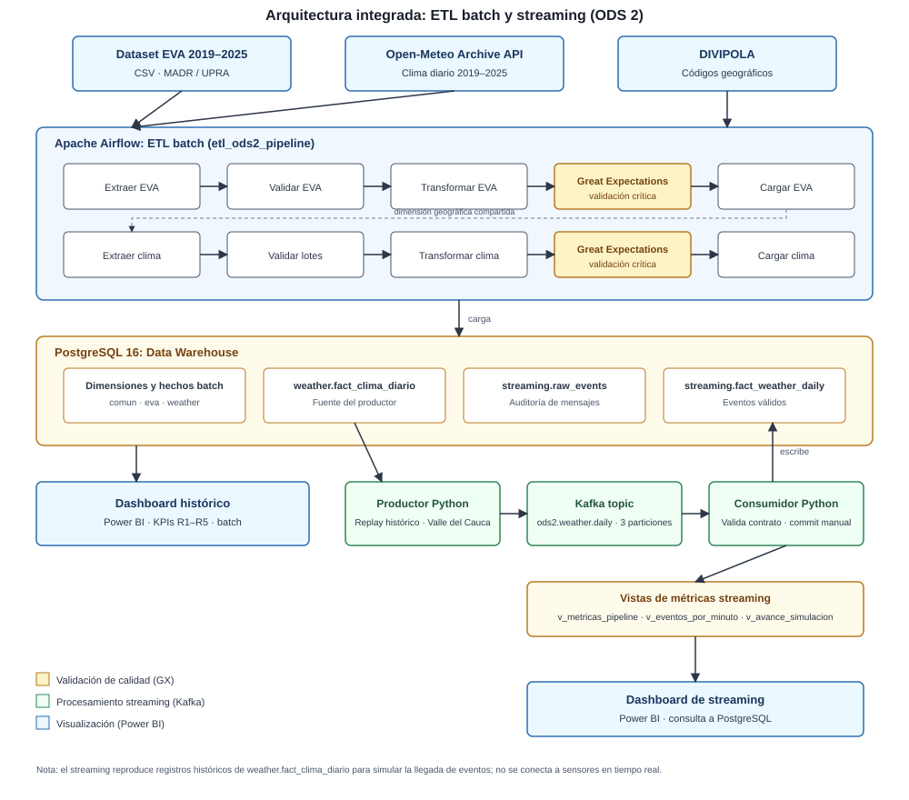
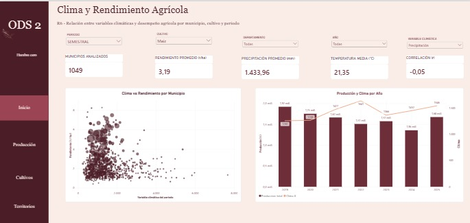
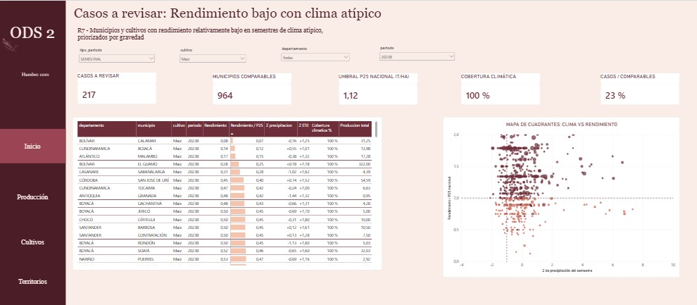

# ODS 2: Agricultural and Meteorological ETL with Batch and Streaming Processing

> **Course:** ETL (G01), Data Engineering and Artificial Intelligence, Universidad Autónoma de Occidente
> **Delivery:** 3 (final, integrated project). Builds on Deliveries 1 and 2.
---

## Table of Contents

1. [Project Overview and Objectives](#1-project-overview-and-objectives)
2. [Data Sources and EDA](#2-data-sources-and-eda)
3. [System Architecture](#3-system-architecture)
4. [Batch ETL Pipeline](#4-batch-etl-pipeline)
5. [Data Quality (Great Expectations)](#5-data-quality-great-expectations)
6. [Data Warehouse](#6-data-warehouse)
7. [Batch Analytical Dashboard](#7-batch-analytical-dashboard)
8. [Streaming Pipeline](#8-streaming-pipeline)
9. [Real-Time Dashboard](#9-real-time-dashboard)
10. [Execution and Reproducibility](#10-execution-and-reproducibility)
11. [Functional Evidence](#11-functional-evidence)
12. [Engineering Decisions and Limitations](#12-engineering-decisions-and-limitations)
13. [Repository Structure](#13-repository-structure)
14. [Previous Deliveries and Team](#14-previous-deliveries-and-team)

---

## 1. Project Overview and Objectives

### 1.1 Problem

This project analyzes agricultural production in Colombia and its relationship with weather conditions. It integrates historical municipal agricultural data (EVA) with daily meteorological observations (Open-Meteo), models them in a dimensional Data Warehouse, and provides two analytical views: a historical view (batch) and a low-latency view of processed weather events (streaming).

The project is aligned with **SDG 2 (Zero Hunger)**, specifically with crop production, yield, and the weather conditions that affect agricultural activity.

The system was built incrementally:

- **Delivery 1:** linear ETL for EVA, dimensional model (MySQL 8.0), data quality framework, and analytical requirements R1–R5.
- **Delivery 2:** Open-Meteo integration, Great Expectations validation, Airflow orchestration, PostgreSQL 16 Data Warehouse, and climate requirements R6–R7.
- **Delivery 3 (this repository):** integrated batch DAG `etl_ods2_pipeline`, Kafka streaming pipeline (producer, topic, consumer), streaming metrics, and a real-time dashboard.

### 1.2 Refined Objectives

- Analyze the historical evolution of municipal agricultural production and yield (R1–R5).
- Analyze the relationship between climate and agricultural performance (R6–R7).
- Automate extraction, transformation, validation, and loading with Apache Airflow.
- Block inconsistent data from reaching the analytical tables through Great Expectations quality gates.
- Process weather events through Kafka and store the results in PostgreSQL.
- Visualize historical indicators (batch dashboard) and event-processing metrics (streaming dashboard).

### 1.3 Objective Achievement Check

The rubric requires showing that the objectives were achieved. Each row links to its evidence.

| Objective | Evidence | Status |
|---|---|---|
| Automated ETL with Airflow | Successful run of `etl_ods2_pipeline` (Section 4.6) | Achieved |
| Quality gates before final tables | Great Expectations validation tasks, failure behavior (Section 5) | Achieved for execution; failure-block evidence pending (Section 5.4) |
| Dimensional model loaded in PostgreSQL | Table row counts (Section 4.6) and schema (Section 6) | Achieved |
| Historical analytical dashboard | Power BI screenshots (Section 7) | Achieved |
| Kafka events processed and stored | Producer and consumer runs (Section 8) | Pending evidence (Section 11.1) |
| Streaming metrics visible in a dashboard | Dashboard before and after new events (Section 9.4) | Pending evidence (Section 9.4) |

### 1.4 Batch vs. Streaming Requirements

| Type | Purpose | Technology | Latency expectation |
|---|---|---|---|
| **Batch** | Analyze historical agricultural and meteorological trends. Integrate sources and update the Data Warehouse. | Python, Pandas, Airflow, PostgreSQL, Power BI | Hours to days. Manual trigger in this project. |
| **Streaming** | Process individual weather events, record their state, and observe processing metrics with low latency. | Kafka, Python, PostgreSQL, Power BI | Seconds per event. |

**Why streaming adds value.** The batch pipeline answers questions about past trends, which are not time-sensitive. Event processing answers operational questions: how many observations have arrived, how many were rejected, whether the pipeline is keeping up, and what the latest conditions are per municipality. These questions need results in seconds, not after a full batch run.

**Simulation disclosure.** The streaming component replays historical records from `weather.fact_clima_diario`. It simulates the progressive arrival of observations and does **not** connect to real-time weather sensors. Events are marked with `is_simulated = true`.

---

## 2. Data Sources and EDA

### 2.1 Data Sources

**A. Municipal Agricultural Evaluations (EVA), static dataset**

- **Origin:** Ministry of Agriculture and Rural Development (MADR) / UPRA.
- **Access:** [Colombian Open Data Portal](https://www.datos.gov.co/Agricultura-y-Desarrollo-Rural/Evaluaciones-Agropecuarias-Municipales-EVA-2019-20/uejq-wxrr/about_data), CSV.
- **Period:** 2019–2025.
- **Volume:** 166,732 records, 1,103 municipalities, 194 crops, 18 columns.
- **Content:** crop, planted and harvested area, production, yield, geographic location, and evaluation period.

**B. Open-Meteo Archive API, dynamic source**

- **Endpoint:** [Open-Meteo Archive API](https://archive-api.open-meteo.com/v1/archive).
- **Period:** 2019-01-01 to 2025-12-31, daily observations.
- **Variables:** mean, maximum, and minimum temperature; precipitation; relative humidity; reference evapotranspiration (ET₀).
- **Extraction:** `src/extraction/open_meteo.py`. Requests are sent in batches of 25 coordinates (45 batches in total). Each batch is retried up to 3 times with a 180-second timeout, on HTTP 429 and 5xx errors. Retries use the `Retry-After` header when present; otherwise, exponential backoff of 30, 60, and 120 seconds. A 5-second pause separates batches, and batches already downloaded and validated are skipped.
- **Batch vs. streaming:** the API supports periodic batch extraction. The streaming component does not call this API; it replays records already loaded into the Data Warehouse (Section 8).

**C. DIVIPOLA, reference dataset**

- Official Colombian geographic coding for departments and municipalities.
- Standardizes territorial codes and joins both sources.
- Municipal codes are stored as 5-character text to preserve leading zeros.

### 2.2 Profiling Results

**EVA profiling** (`notebooks/01_source_profiling.ipynb`)

| Aspect | Finding |
|---|---|
| Dimensions | 166,732 records, 18 attributes |
| Null values | None in initial profiling |
| Empty strings | None |
| Exact duplicates | None in initial analysis |
| Formats | Potential inconsistencies in DANE codes and decimal separators |
| Mathematical consistency | Production, harvested area, and yield verified: Yield = Production / Harvested area |
| Periodicity | Annual records are not the sum of semesters A and B |
| Methodological anomaly | 13,208 records after 2022 where harvested area exceeds planted area for transitory crops |
| Historical stability | No dimension changes between 2019 and 2025 justified SCD Type 2 |

**Open-Meteo profiling** (`notebooks/02_open_meteo_profiling.ipynb`)

- Completeness: 0 null values across the six meteorological variables in the profiled batches.
- Physical validity: 0 negative precipitation or ET₀ values, 0 humidity values outside 0–100 %, and `Minimum ≤ Mean ≤ Maximum` holds for all records. Coordinates are within valid bounds.
- Uniqueness: no duplicate municipality-date keys in the profiled batches.
- Granularity: a direct join between EVA (municipality-crop-period) and climate (municipality-date) would multiply agricultural rows across days, so climate must be aggregated to the EVA periods before joining.

### 2.3 How EDA Findings Shaped the Pipeline

| EDA finding | Decision in the pipeline |
|---|---|
| Leading zeros in DANE/DIVIPOLA codes | Codes are read and stored as text (`VARCHAR`). |
| Decimal separator inconsistencies | Separators are normalized before numeric conversion. |
| Annual records are not sums of semesters | Annual and semester periods are kept as distinct entities. Grain: `municipality + crop + year + period`. |
| Harvested area > planted area after 2022 | Preserved, not corrected. No justified assumption exists to change it. Documented as a methodological break. |
| Production / area / yield consistency | Numeric consistency rule in validation. |
| Stable dimensions 2019–2025 | SCD Type 2 not implemented. Dimensions are Type 1. |
| Meteorological values must be physically plausible | Range rules for humidity, precipitation, ET₀, and temperature order (Section 5). |
| Climate has daily grain, EVA has period grain | Daily climate is aggregated to EVA periods in the database (Section 8.5). Coverage is tracked to show how complete each aggregate is. |

---

## 3. System Architecture

### 3.1 Architecture Diagram

The diagram below shows the integrated batch and streaming flow. GitHub renders it directly.



### 3.2 Technology Stack

| Layer | Tool / Technology | Version / Configuration | Purpose |
|---|---|---|---|
| Orchestration | Apache Airflow | 3.1.8, CeleryExecutor | Schedule and monitor batch ETL workflows |
| Event streaming | Apache Kafka | 4.1.1, single broker, KRaft mode | Publish, retain, and distribute events |
| Task broker | Redis | 7.2 | Celery broker for Airflow |
| Data sources | EVA (CSV), DIVIPOLA, Open-Meteo API | — | Historical and periodically updated data |
| Data storage | PostgreSQL | 16 | Dimensional model and processed streaming data |
| Quality checks | Great Expectations | 1.24.0 | Validate data before loading final tables |
| Transformation | Python, Pandas, NumPy | — | Clean, integrate, and transform data |
| Visualization | Power BI | PBIX files | Historical and low-latency analytics |
| Containerization | Docker Compose | — | Reproducible service environment |
| Versioning | Git, GitHub, Markdown | — | Version control and documentation |

### 3.3 Component Responsibilities

- **Airflow** runs the batch DAGs. It does not run the Kafka producer or consumer.
- **Kafka** runs as a single broker. The topic `ods2.weather.daily` is fed by the producer.
- **Producer and consumer** run as independent Python processes, outside Airflow.
- **PostgreSQL** holds the batch schemas (`comun`, `eva`, `weather`) and the streaming schema (`streaming`). The streaming schema does not modify batch tables.

---

## 4. Batch ETL Pipeline

### 4.1 Extraction

- **EVA:** `src/extraction/eva.py` reads the CSV and keeps geographic codes as text.
- **Open-Meteo:** `src/extraction/open_meteo.py` queries the archive API in batches and persists each batch (Section 2.1).

### 4.2 Transformation

Located in `src/transformation/`:

- `transformacion_eva.py`: EVA cleaning, typing, and decimal normalization.
- `transform_weather.py`: consolidates the 45 weather batches into `weather_processed.csv`, with date and numeric normalization.

Anomalies are preserved, not corrected (Section 2.3).

### 4.3 Raw Validation

- `src/validation/validate_eva.py`: structure and format of the raw EVA data.
- `src/validation/validate_weather_batches.py`: schema, types, finite values, and coordinates for each weather batch.

### 4.4 Loading

Located in `src/load/`:

- `load_eva.py`: loads `comun.dim_geografia`, `eva.dim_cultivo`, `eva.dim_tiempo`, and `eva.fact_produccion_agricola`.
- `load_weather.py`: loads `weather.dim_fecha` and `weather.fact_clima_diario`. It resolves surrogate keys in memory and upserts with `ON CONFLICT (sk_geografia, sk_fecha) DO UPDATE` (Section 8.4).

### 4.5 DAG Structure

Three DAGs are defined in `dags/`:

| DAG | File | Responsibility |
|---|---|---|
| `etl_ods2_pipeline` | `dags/dag_ods2.py` | **Integrated pipeline.** Runs both branches and the shared-dimension dependency. |
| `dag_eva_agricola` | `dags/dag_eva.py` | EVA branch only |
| `dag_weather_open_meteo` | `dags/dag_weather.py` | Weather branch only |

**Execution sequence of `etl_ods2_pipeline`:**

```text
EVA branch:
  extraer_eva → validar_eva_staging → transformar_eva → validar_eva_procesado → cargar_eva
                                                                                    │
                                                                                    ▼
Weather branch (cargar_weather waits for cargar_eva):
  extraer_weather → validar_batches_weather → transformar_weather → validar_weather_procesado → cargar_weather
```

Each task runs its script with `subprocess.run(..., check=True)`. A non-zero exit code raises an exception in the Airflow task, so the task fails and its downstream tasks do not run.

**DAG configuration** (from `dags/dag_ods2.py`):

| Setting | Value | Meaning |
|---|---|---|
| `schedule` | `None` | Manual trigger only |
| `catchup` | `False` | No historical backfill |
| `max_active_runs` | `1` | One run at a time |
| `retries` | `0` | A failed task is not retried (Section 12.2) |
| `execution_timeout` | 12 hours | Upper bound per task |

**Dependency rule.** The weather load waits for the EVA load because both use the shared geography dimension `comun.dim_geografia`, which EVA initializes.

### 4.6 Evidence of Successful Execution



*Figure 4.6.A. Run of `etl_ods2_pipeline` with all tasks in success state. The run finished in 19 min 13 s.*

Row counts per table after the run:

```sql
SELECT 'comun.dim_geografia' AS tabla, COUNT(*) FROM comun.dim_geografia
UNION ALL SELECT 'eva.dim_cultivo', COUNT(*) FROM eva.dim_cultivo
UNION ALL SELECT 'eva.dim_tiempo', COUNT(*) FROM eva.dim_tiempo
UNION ALL SELECT 'eva.fact_produccion_agricola', COUNT(*) FROM eva.fact_produccion_agricola
UNION ALL SELECT 'weather.dim_fecha', COUNT(*) FROM weather.dim_fecha
UNION ALL SELECT 'weather.fact_clima_diario', COUNT(*) FROM weather.fact_clima_diario;
```


### 4.7 Failure Isolation





*Figure 4.7.A and 4.7.B. When `extraer_weather` fails, the downstream weather tasks are marked `upstream_failed` and the EVA branch continues to success.*

The circuit-breaker behavior is described in Section 10.2.

---

## 5. Data Quality (Great Expectations)

### 5.1 Quality Dimensions

| Dimension | Rule | Purpose |
|---|---|---|
| Completeness | Required fields are present and not null | Avoid incomplete records |
| Validity | Types and formats are correct | Avoid incompatible values |
| Uniqueness | Keys and duplicates are checked | Avoid repeated records |
| Referential integrity | Municipal codes match DIVIPOLA and dimensions | Guarantee valid geographic references |
| Numeric consistency | Mathematical relationships and ranges hold | Avoid incoherent values |
| Temporal consistency | Dates and periods are coherent | Keep observations coherent |
| Meteorological integrity | Temperature, precipitation, humidity, and ET₀ are physically plausible | Reject incompatible values |

### 5.2 Great Expectations Suites

Great Expectations is the primary framework for schema, completeness, type, and range checks. Custom Python checks cover business rules that the standard expectations do not express, such as the coverage metrics and the weather check codes WX-POST-01 to WX-POST-13.

The two GX validations run as tasks in the integrated DAG. They were developed in Delivery 2 and reused without changes in this delivery.

| Task | Script | Dataset | Main expectations |
|---|---|---|---|
| `validar_eva_procesado` | `src/validation/validate_eva_processed.py` | EVA processed | Not-null and type checks; uniqueness of the natural grain |
| `validar_weather_procesado` | `src/validation/validate_weather_processed.py` | `weather_processed.csv` | `expect_table_columns_to_match_set`; `expect_column_values_to_not_be_null`; `expect_column_values_to_be_of_type`; `expect_column_values_to_be_between` (e.g., humidity 0–100, precipitation ≥ 0); uniqueness of municipality-date |

The weather validation writes a JSON report and temporary Data Docs. A baseline run returned `APPROVED` with exit code 0.

### 5.3 Failure Behavior

1. A failed validation makes the script exit with a non-zero code.
2. `subprocess.run(..., check=True)` raises an exception in the Airflow task, so the task is marked failed (red).
3. Downstream tasks, including the load (`cargar_eva` or `cargar_weather`), are marked `upstream_failed` and do not run.
4. The Data Warehouse receives no data from the failed branch.

The EVA branch and the weather branch are isolated by this rule: a failure in one does not alter the other, except for the final `cargar_weather` dependency on `cargar_eva`.


### 5.5 Validation of Streaming Events

Separate from Great Expectations, the streaming event contract (`src/streaming/event_contract.py`) enforces these rules:

- Required fields are present; unexpected fields are rejected.
- Values match their declared types.
- `schema_version` is `1.0` and `event_type` is `daily_weather_report`.
- `municipality_code` has five digits.
- `observation_time` is `YYYY-MM-DD`; `published_at` is ISO 8601 with time zone.
- `precipitation_mm` and `et0_mm` are not negative.
- `relative_humidity` is between 0 and 100.
- `temperature_min ≤ temperature_mean ≤ temperature_max`.
- The Kafka key equals `municipality_code`.
- `event_id` corresponds to the data in the event.

---

## 6. Data Warehouse

### 6.1 Dimensional Model

PostgreSQL 16 with schemas separated by responsibility.

| Schema | Table | Type | Description |
|---|---|---|---|
| `comun` | `dim_geografia` | Dimension | Departments and municipalities (DIVIPOLA) |
| `eva` | `dim_cultivo` | Dimension | Crop classification and cycle |
| `eva` | `dim_tiempo` | Dimension | Agricultural year and period (annual, semester A, semester B), with start and end dates |
| `eva` | `fact_produccion_agricola` | Fact | Production by municipality, crop, and period |
| `weather` | `dim_fecha` | Dimension | Calendar dimension for daily observations |
| `weather` | `fact_clima_diario` | Fact | Daily measurements by municipality and date, with `source_batch_id` lineage |
| `streaming` | `raw_events` | Audit | Original Kafka messages and their processing status |
| `streaming` | `fact_weather_daily` | Fact | Valid processed events linked to geography and date |

**Climate aggregated to EVA periods.** `fact_clima_periodo` is not a physical table. It is a native SQL query over `weather.fact_clima_diario`, `weather.dim_fecha`, and `eva.dim_tiempo`. It aggregates daily climate to each EVA period (grain: municipality, period) and feeds Power BI (Section 7).

### 6.2 Granularity

- **Agricultural production:** municipality + crop + year + period.
- **Weather (batch):** municipality + observation date.
- **Climate per period:** municipality + EVA period.
- **Streaming:** one daily weather event per municipality, date, and simulation.

### 6.3 Schema Diagram



### 6.4 Loading Strategy

- **Surrogate keys:** `load_weather.py` builds in-memory lookups. `sk_geografia` comes from `comun.dim_geografia` using `codigo_municipio`. The script stops with an explicit error if a municipality is missing, so orphan records are never loaded. `sk_fecha` comes from `weather.dim_fecha`, which is populated with missing dates before the lookup.
- **Bulk insert:** `psycopg2.extras.execute_values` in batches of 5,000 records, with a page size of 1,000.
- **Idempotency:** `ON CONFLICT (sk_geografia, sk_fecha) DO UPDATE` updates existing records instead of duplicating them. Reruns are safe (Section 10.2, Test C).
- **Aggregation to periods:** precipitation and ET₀ are summed over each period; temperatures and relative humidity are averaged. Coverage (`dias_esperados`, `dias_observados`, `cobertura_porcentual`) is tracked for each municipality-period.

### 6.5 Batch and Streaming Separation

The `streaming` schema is independent from `eva` and `weather`. Events never modify `eva.fact_produccion_agricola` or `weather.fact_clima_diario`. They are stored only in `streaming.*`.

### 6.6 SQL Scripts

- `sql/weather/`: weather schema and tables.
- `sql/streaming/01_create_schema.sql`: streaming schema and tables.
- `sql/streaming/02_metrics_views.sql`: streaming metric views.
- `sql/streaming/03_views_ajustes.sql`: view adjustments.
- `sql/streaming/04_ventana_10s.sql`: 10-second windowing.

---

## 7. Batch Analytical Dashboard

This is the historical Power BI dashboard from Deliveries 1 and 2, updated to the integrated model. It is **not** the streaming dashboard (Section 9).

**Connection:** Power BI Desktop, PostgreSQL connector, Import mode, database `ods2_dw`. All figures come from the Data Warehouse. No CSV or intermediate file is used.

### 7.1 Requirements

| Requirement | Question | Visualization |
|---|---|---|
| R1 | Temporal evolution of production and yield, 2019–2025 | Combined time chart |
| R2 | Territorial differences in yield | Tables and rankings by department and municipality |
| R3 | Relationship between planted area, harvested area, and production | Scatter plot |
| R4 | Strategic crops and their yield | Crop ranking |
| R5 | Transitory vs. permanent crops and their periods | Comparative visualization |
| R6 | How do climate and agricultural performance relate by municipality, crop, and period? | Climate-vs-yield scatter, production-and-climate combo, climate variable selector |
| R7 | Which municipalities and crops show relatively low yield during atypical climate? | Prioritized case table, quadrant map |

### 7.2 KPIs

| KPI | Calculation | Unit |
|---|---|---|
| Total production | Sum of agricultural production | Tons |
| Total harvested area | Sum of harvested area | Hectares |
| Average global yield | Total production / total harvested area | Tons per hectare |
| Analyzed municipalities | Municipalities with computable yield in the selection | Count |
| Average precipitation | Sum of daily precipitation over the period, averaged across municipality-period combinations | mm |
| Mean temperature | Average of daily mean temperature over the period | °C |
| Correlation (r) | Pearson correlation between the selected climate variable and yield across municipalities; descriptive only | −1 to +1 |

Yield is always computed as total production divided by total harvested area, never as an average of row-level yields.

### 7.3 R7 Criteria

A municipality-crop-semester is flagged when all three hold:

1. **Low yield:** yield is at or below the national 25th percentile (P25) of the same crop and semester, with at least 10 comparable municipalities.
2. **Atypical climate:** semester precipitation z-score ≤ −1, or semester ET₀ z-score ≥ +1. Each z-score compares the semester with the municipality's own 2019–2025 history for the same semester (A or B).
3. **Sufficient coverage:** valid daily records ≥ 95 % of the days in the period.

The dashboard flags cases for review. It does **not** label them as drought or water stress, because low precipitation or high ET₀ alone does not establish that.

### 7.4 Filters

- Period (`tipo_periodo`), year, crop, crop group, department.
- Climate variable selector: precipitation, mean temperature, ET₀, relative humidity.

### 7.5 Screenshots


*Figure 7.5.A. Final integrated dashboard for agricultural productivity analysis aligned with SDG 2.*



*Figure 7.5.B. Climate and agricultural performance (R6).*



*Figure 7.5.C. Cases to review under atypical climate (R7).*


### 7.6 Methodological Notes

- **Climate source:** Open-Meteo is based on ERA5/ERA5-Land reanalysis, a model, not station data (cells of about 25 km). It can over- or under-estimate precipitation in mountainous terrain. Example: Pradera (Valle del Cauca) shows about 15,000 mm annual precipitation with correct coordinates and complete daily series. The value is kept and disclosed.
- **Correlation is not causation.** Results are descriptive associations at municipality level. Altitude, soils, technology, and irrigation are not measured.
- **Permanent crops** (for example, coffee) have only annual periods in EVA, so they do not appear in semester views.
- **Climate has no crop dimension.** Climate is attached to municipality and period, so every analysis is conditioned on the crop produced in that municipality.

---

## 8. Streaming Pipeline

### 8.1 Event Generation Strategy

The streaming component does not receive sensor data. It replays historical daily records from `weather.fact_clima_diario` to simulate their arrival.

- **Source:** `weather.fact_clima_diario`, joined with `comun.dim_geografia` and `weather.dim_fecha`.
- **Scope:** municipalities of Valle del Cauca (department code `76`).
- **Parameters:** start date, number of simulated days, and interval between days.
- **Frequency:** one batch of events per simulated day, separated by the configured interval (5 seconds in the demo).
- **Grouping:** each run generates a `simulation_id` that groups its events.
- **Simulation flags:** `is_simulated = true` and `source_mode` identify replayed events.
- **No repeated values:** each record is published once. The producer does not republish the same observation.

**Why low latency adds value.** Operational questions (rejection rate, pipeline progress, current conditions per municipality) lose value when answered hours later. Each event is processed in seconds and the metrics update immediately.

### 8.2 Kafka Producer

**File:** `src/producer/producer.py`

1. Connects to the business PostgreSQL database.
2. Queries `weather.fact_clima_diario` with dimension joins.
3. Filters department `76`.
4. Orders records by observation date.
5. Generates a `simulation_id`.
6. Builds JSON events.
7. Validates each event against the contract.
8. Publishes to Kafka with `municipality_code` as the message key.

**Producer configuration:** `acks="all"`, 5 retries, limited in-flight requests, delivery confirmation, and `flush()` before exit.

### 8.3 Kafka Topic

| Parameter | Value |
|---|---|
| Broker | Apache Kafka 4.1.1 |
| Topic | `ods2.weather.daily` |
| Partitions | 3 |
| Replication factor | 1 |
| Message key | `municipality_code` |
| Local listener | `localhost:9092` |
| Internal Docker listener | `kafka:19092` |

Kafka runs as a single broker in KRaft mode. There is no replication or high availability (Section 12.2).

### 8.4 Event Contract

**File:** `src/streaming/event_contract.py`. Version `1.0`, event type `daily_weather_report`. Each event has 19 fields:

| Field | Type | Description |
|---|---|---|
| `schema_version` | string | Contract version (`1.0`) |
| `event_id` | string | Event identifier, derived from event content |
| `event_type` | string | `daily_weather_report` |
| `simulation_id` | string | Identifier of the simulation run |
| `source` | string | Original source (Open-Meteo) |
| `source_mode` | string | Generation mode (replay) |
| `is_simulated` | boolean | `true` for replayed events |
| `municipality_code` | string (5 digits) | Municipal code; also the Kafka key |
| `municipality` | string | Municipality name |
| `department_code` | string | Department code |
| `department` | string | Department name |
| `observation_time` | string (`YYYY-MM-DD`) | Observation date |
| `published_at` | string (ISO 8601 with time zone) | Publication timestamp |
| `temperature_mean` | number | Mean temperature (°C) |
| `temperature_max` | number | Maximum temperature (°C) |
| `temperature_min` | number | Minimum temperature (°C) |
| `precipitation_mm` | number (≥ 0) | Precipitation (mm) |
| `relative_humidity` | number (0–100) | Relative humidity (%) |
| `et0_mm` | number (≥ 0) | Reference evapotranspiration (mm) |

The event identifier, timestamp, and event key required by the rubric are `event_id`, `published_at`, and `municipality_code`.

### 8.5 Kafka Consumer

**File:** `src/consumer/consumer.py`. Subscribes to `ods2.weather.daily`.

For each message:

1. Receives and decodes the message, then parses the JSON.
2. Stores the original payload in `streaming.raw_events`.
3. Checks whether the message is already registered.
4. Validates the event contract.
5. Checks that the municipality exists in `comun.dim_geografia`.
6. Checks that the date exists in `weather.dim_fecha`.
7. Inserts valid events into `streaming.fact_weather_daily`.
8. Updates the status of the raw record.
9. Commits the Kafka offset manually, after the PostgreSQL transaction completes.

### 8.6 Duplicates, Errors, and Offsets

- `streaming.raw_events` has a unique constraint on `(kafka_topic, kafka_partition, kafka_offset)`.
- `streaming.fact_weather_daily` has unique constraints on `raw_event_id` and `event_id`.
- Auto-commit is disabled. Offsets are committed only after successful persistence.
- **Infrastructure or persistence error:** the consumer logs the error, does not commit the offset, and stops, so it does not advance unsafely.
- **Contract or integrity error:** the event is stored with status `rejected` and its error message. It is not inserted into `streaming.fact_weather_daily`.

### 8.7 Streaming Metrics

| View | Metrics |
|---|---|
| `streaming.v_metricas_pipeline` | Total events, processed events, rejected events, rejection rate, last processing time |
| `streaming.v_eventos_por_minuto` | Event count by status in 10-second windows (`date_bin`) |
| `streaming.v_avance_simulacion` | Processed events, days, reported municipalities, expected municipalities, average latency |
| `streaming.v_clima_por_jornada` | Temperature, precipitation, humidity, and ET₀ per simulated day |
| `streaming.v_clima_por_municipio` | Weather indicators aggregated per municipality |
| `streaming.v_eventos_rechazados` | Rejected events and their errors |

**Metrics on the real-time dashboard (minimum three):**

1. Processed events and rejection rate (`v_metricas_pipeline`).
2. Events per 10-second window (`v_eventos_por_minuto`).
3. Simulation progress and average latency (`v_avance_simulacion`).


---

## 9. Real-Time Dashboard

### 9.1 Consumer-to-Dashboard Integration

The consumer writes to PostgreSQL. Power BI reads the views in the `streaming` schema. The dashboard connects through the database, not directly to Kafka.

**Why this mechanism:** Power BI does not consume Kafka topics directly. A continuously updated table or view works with the visualization tool and keeps the metrics queryable and auditable.

### 9.2 Update Frequency

- The views recalculate from `streaming.*` on each query.
- Events are grouped in 10-second windows (`04_ventana_10s.sql`).

### 9.3 Dashboard File

`dashboard/DASHBOARD STREAMING.pbix`
run and again after it finishes, and note the event count or rejection rate that changes.]

### 9.4 Distinction from the Historical Dashboard

| Aspect | Historical dashboard (Section 7) | Real-time dashboard (this section) |
|---|---|---|
| Data | `eva` and `weather` schemas | `streaming` schema |
| Time scope | 2019–2025 | Current simulation and processed events |
| Update | Batch, after DAG runs | After each processed event |
| Purpose | Historical trends and territorial analysis | Pipeline behavior and event-level metrics |

---

## 10. Execution and Reproducibility

### 10.1 Software Requirements

- Docker Desktop and Docker Compose.
- Python 3.x compatible with `requirements.txt`.
- Git.
- Power BI Desktop (to open the PBIX files).
- pgAdmin or `psql` (to query PostgreSQL).

### 10.2 Clone and Configure

```bash
git clone https://github.com/Negary1/Proyecto-final.git
cd Proyecto-final
cp .env.example .env        # PowerShell: Copy-Item .env.example .env
```

Replace the example values in `.env`. The file is listed in `.gitignore` and must not be committed.

| Variable | Purpose |
|---|---|
| `POSTGRES_DB`, `POSTGRES_USER`, `POSTGRES_DB_PASSWORD` | Business database |
| `POSTGRES_HOST`, `POSTGRES_PORT` | Host and port for local execution (5433) |
| `AIRFLOW_DB`, `AIRFLOW_DB_USER`, `AIRFLOW_DB_PASSWORD` | Airflow metadata database |
| `AIRFLOW_ADMIN_USERNAME`, `AIRFLOW_ADMIN_PASSWORD` | Airflow administrator |
| `AIRFLOW_FERNET_KEY` | Airflow encryption key |
| `AIRFLOW__API_AUTH__JWT_SECRET` | API authentication secret |
| `KAFKA_BOOTSTRAP_SERVERS` | Kafka broker address |
| `KAFKA_TOPIC` | Event topic |

### 10.3 Start the Services

```bash
docker compose up -d --build
docker compose ps
```

| Service | Function | Local port |
|---|---|---|
| `postgres` | Business database | 5433 |
| `airflow-postgres` | Airflow metadata | Internal |
| `redis` | Celery broker | Internal |
| `airflow-apiserver` | Airflow web UI | 8081 |
| `airflow-scheduler` | Task scheduling | Internal |
| `airflow-dag-processor` | DAG processing | Internal |
| `airflow-worker` | Task execution | Internal |
| `airflow-triggerer` | Trigger management | Internal |
| `kafka` | Event broker | 9092 |

### 10.4 Run the Batch ETL

1. Open `http://localhost:8081` and log in with the credentials from `.env`.
2. Enable and trigger `etl_ods2_pipeline` manually.
3. Wait until both branches finish in green.

### 10.5 Prepare the Streaming Schema

After the batch pipeline has loaded the geography, date, and weather tables, run these scripts in PostgreSQL if they are not already applied:

1. `sql/streaming/01_create_schema.sql`
2. `sql/streaming/02_metrics_views.sql`
3. `sql/streaming/03_views_ajustes.sql`
4. `sql/streaming/04_ventana_10s.sql`

### 10.6 Install Local Dependencies

Needed only to run the producer and consumer outside Docker.

```powershell
python -m venv .venv
.\.venv\Scripts\Activate.ps1
pip install -r requirements.txt
$env:PYTHONPATH = "$PWD\src"
```

### 10.7 Start the Consumer

In terminal 1, from the project root:

```bash
python -m src.consumer.consumer
```

The consumer connects to the broker and waits for messages.

### 10.8 Start the Producer

In terminal 2, from the project root:

```bash
python -m src.producer.producer --start-date 2025-01-01 --simulation-days 3 --interval-seconds 5
```

| Parameter | Purpose |
|---|---|
| `--start-date` | First simulated date |
| `--simulation-days` | Number of simulated days to replay |
| `--interval-seconds` | Interval between simulated days |

### 10.9 Verify the Results

```sql
-- Event status counts
SELECT processing_status, COUNT(*) AS total
FROM streaming.raw_events
GROUP BY processing_status;

-- Processed events
SELECT * FROM streaming.fact_weather_daily ORDER BY loaded_at DESC;

-- Pipeline metrics
SELECT * FROM streaming.v_metricas_pipeline;

-- Simulation progress
SELECT * FROM streaming.v_avance_simulacion;

-- Rejected events
SELECT * FROM streaming.v_eventos_rechazados;
```

### 10.10 Run the Contract Tests

```bash
python -m unittest test.test_event_contract -v
```

## 11. Functional Evidence

Evidence must come from actual execution. Code screenshots alone do not satisfy this section.

### 11.1 Evidence Checklist

| # | Evidence | Section | Status |
|---|---|---|---|
| 1 | Successful run of `etl_ods2_pipeline` | 4.6 | Included |
| 2 | Failure isolation of the weather branch | 4.7 | Included |
| 3 | Great Expectations validation results | 5.4 | Pending |
| 4 | Data Warehouse row counts | 4.6 | Pending (query output) |
| 5 | Producer publishing events | 8 | Pending |
| 6 | Consumer processing events | 8 | Pending |
| 7 | Rejected events in `streaming.raw_events` | 11.2 | Pending |
| 8 | Metrics updated in streaming views | 8.7 | Pending |
| 9 | Real-time dashboard before and after new events | 9.4 | Partial (after only) |
| 10 | Consumer stopped and restarted experiment | 11.3 | Pending |

### 11.2 Invalid Event Experiment

**Script:** `test/publish_invalid_event.py`. Publishes an event with relative humidity of 150 %.

```bash
python test/publish_invalid_event.py
```

Verify the rejection:

```sql
SELECT event_id, processing_status, error_message
FROM streaming.raw_events
WHERE processing_status = 'rejected'
ORDER BY received_at DESC;
```


### 11.3 Consumer Interruption Experiment

Required by the rubric. Run the experiment and record the results.

1. Start the consumer and the producer.
2. Stop the consumer (Ctrl+C) while the producer is still publishing. 
3. Observe how many events accumulated in the topic (offset lag). 
4. Restart the consumer. 
5. Confirm that accumulated events are processed and none are lost or duplicated.

```sql
SELECT kafka_partition, MIN(kafka_offset), MAX(kafka_offset), COUNT(*)
FROM streaming.raw_events
GROUP BY kafka_partition;
```


### 11.4 Contract Tests

File: `test/test_event_contract.py`. Covers required fields, municipal codes, negative precipitation, humidity ranges, temperature order, date formats, temporal coherence, event identifiers, and key-to-code matching.


---

## 12. Engineering Decisions and Limitations

### 12.1 Design Decisions

**Schema separation.** PostgreSQL uses separate schemas for shared dimensions, agricultural data, meteorological data, and streaming events. Batch and streaming stay independent.

**Dimension reuse.** The streaming pipeline reuses the geography and date dimensions loaded by the batch pipeline, avoiding duplicate territorial and temporal references.

**Historical replay.** Historical weather records simulate events. This tests the producer, broker, consumer, persistence, and dashboards without live sensors.

**Raw audit table.** Every message is stored in `streaming.raw_events` with its status and rejection reason, separating received messages from those that reach the analytical table.

**Manual offset commit.** Offsets are committed after the PostgreSQL transaction completes, reducing the risk of losing messages that were read but not persisted.

**Gate-based loading.** Each load task runs only after its validation task succeeds. A failed validation blocks the load.

**Preservation of anomalies.** The EVA anomaly (harvested area > planted area after 2022) is kept and documented, not silently corrected.

**Shared geography dependency.** The weather load waits for the EVA load so that `comun.dim_geografia` exists before municipalities are resolved.

### 12.2 Known Limitations

**Agricultural data**
- EVA has a methodological break after 2022 for certain transitory crops (Section 1.3 of Delivery 2).
- No soil, input, or market variables are included.
- Granularity is annual or semester, not daily.

**Weather and streaming**
- Streaming replays historical data. It does not receive real-time observations.
- The producer is limited to Valle del Cauca.
- The producer requires `weather.fact_clima_diario` to be loaded beforehand.
- Producer and consumer are run manually. They are not orchestrated by Airflow.
- Kafka runs a single broker with replication factor 1. There is no high availability.
- The contract implements version 1.0 only.
- No alerting mechanism is implemented.

**Orchestration**
- All DAG tasks use `retries=0`. A transient failure (for example, an API timeout) stops the run until it is triggered again. Extraction already retries internally (Section 2.1), but no task-level retry policy is configured.

### 12.3 Reliability Considerations

- If the consumer fails after reading a message but before committing its offset, the message is redelivered. Unique constraints on `(kafka_topic, kafka_partition, kafka_offset)`, `raw_event_id`, and `event_id` prevent duplicate facts. 
- A stopped consumer does not lose messages while they remain in the topic within the retention period. 

### 12.4 Security Considerations

- Credentials come from environment variables in `.env`, with `.env.example` as the template.
- `.env`, passwords, Fernet keys, and JWT secrets are not committed.
- `.gitignore` separates local configuration from source code.

---

## 13. Repository Structure

```text
Proyecto-final/
├── assets/                     # Screenshots referenced in this README
│   ├── Dashboard.jpg
│   ├── DashboardNew.jpg
│   ├── dashboardr6.jpeg
│   ├── dashboardr7.jpeg
│   ├── prueba.jpeg
│   ├── pruebaB.jpeg
│   └── pruebaBB.jpeg
├── dags/
│   ├── dag_eva.py
│   ├── dag_weather.py
│   └── dag_ods2.py
├── dashboard/
│   └── DASHBOARD STREAMING.pbix
├── data/
│   ├── raw/
│   ├── processed/
│   ├── source/
│   └── validation/
├── notebooks/
│   ├── 01_source_profiling.ipynb
│   ├── 02_open_meteo_profiling.ipynb
│   └── pruebas.ipynb
├── outputs/
│   ├── profiling/
│   └── validation/
├── reports/
│   └── validation/
├── sql/
│   ├── streaming/
│   └── weather/
├── src/
│   ├── consumer/
│   ├── extraction/
│   ├── load/
│   ├── producer/
│   ├── streaming/
│   ├── transformation/
│   └── validation/
├── test/
│   ├── publish_invalid_event.py
│   └── test_event_contract.py
├── .dockerignore
├── .env.example
├── .gitignore
├── Dockerfile
├── docker-compose.yml
├── requirements.txt
├── requirements-airflow.txt
└── requirements-dev.txt
```

---

## 14. Previous Deliveries and Team

### 14.1 Previous Deliveries

The repositories for Deliveries 1 and 2 remain available and unchanged:

- Delivery 1: [https://github.com/Negary1/Data-Warehouse-EVA-ODS/tree/main/assets]
- Delivery 2: [https://github.com/santiagobotero-png/ODS_2/tree/main]

### 14.2 Team

| Member | Main responsibility |
|---|---|
| Santiago Botero Dorado | Data engineering: initial EVA profiling, quality assurance, cleaning, and extraction pipeline |
| Valentina Díaz Lovatón | Data architecture: grain definition, dimensional design, DDL scripts, surrogate keys, referential integrity |
| Fergie Montero Hernández | Business analysis and BI: analytical requirements R1–R7, SQL queries, historical dashboard, findings documentation |
